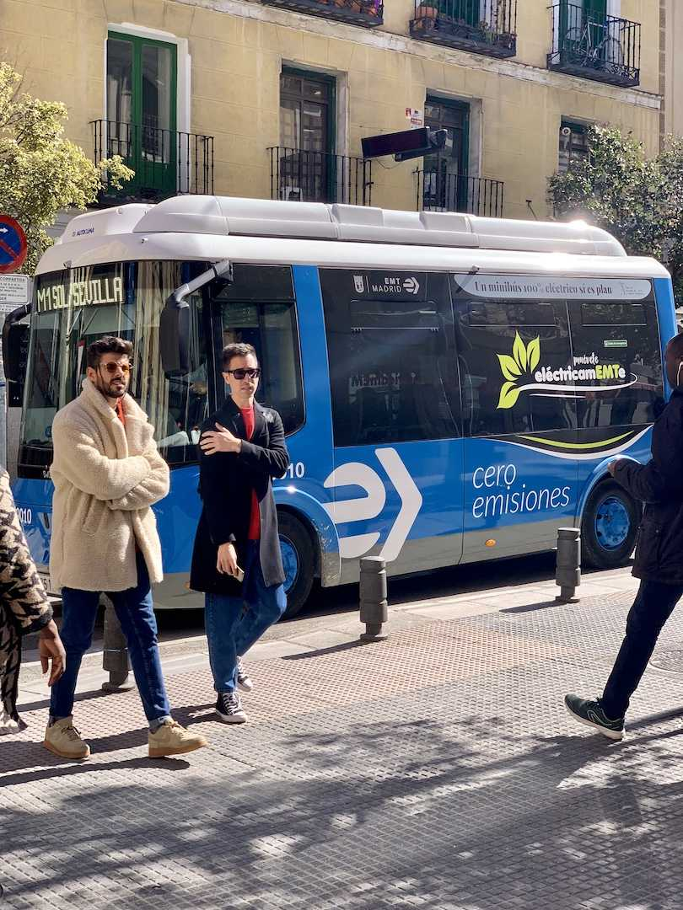
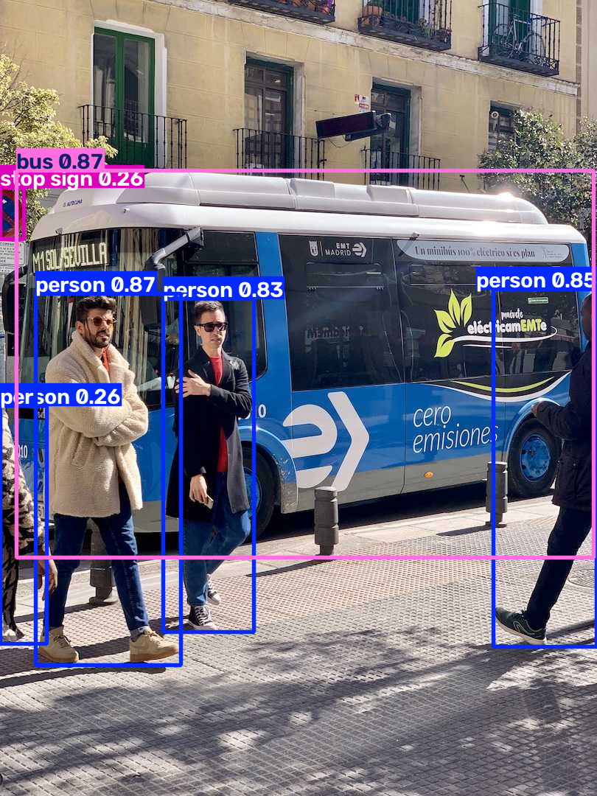

# Street Vision Detector 

A smart computer vision project utilizing YOLOv8 for real-time object detection and recognition.

## Before & After
Here is a comparison showing the input image before detection and the final output with bounding boxes:

### Original Image (Before)
<p align="center">
  
</p>

### Detection Result (After)
<p align="center">
  
</p>

## Installation & Setup
To run this project, make sure to install the required Ultralytics library using pip:

```bash
pip install ultralytics
